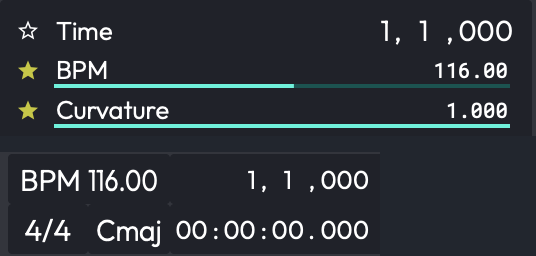
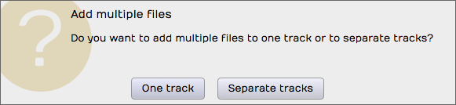
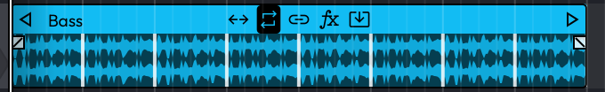
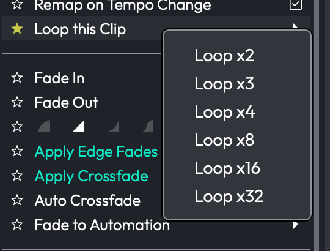
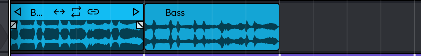
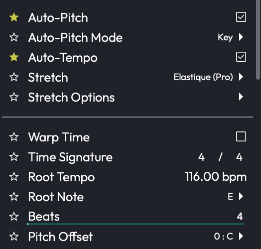

# Working With Loops

Loops let you build up a part from short, repeating audio files. You
can drag in files from your loop library as Audio clips, repeat them
with the Duplicate (D) action, or switch any Audio clip into looping
mode and roll out repetitions over as many bars as you want: for
example, to extend a short loop into a beat that plays over the full
length of a song. An Audio clip's loop settings appear in the
Actions panel and in the [Detail Editor](detail-editor.md) (**Clip** tab),
as described in [Loop Properties](#loop-properties).

## Getting Loops Into Waveform

There are four ways to copy loops into an Edit.

1.  Use the **Files** tab of the Browser to navigate to the audio files
    and loops on your system, then drag them to tracks in the Edit. A
    loop appears as an outline while you drag it, until you drop it.
2.  Use the Search tab of the Browser to search for loops, then drag
    them into your Edit. You can preview loops in the Browser to help
    you pick the right one for the song.
3.  Drag them from your computer's desktop and drop them onto tracks.
4.  From the main menu, choose *File > Import an audio or MIDI
    file...*, navigate to a file on your system and click **Open**. The
    **Select a file to import** dialog box includes a basic audition
    function with **Auto-play**.

> 📝 **Note:** Beyond the common formats (WAV, AIFF, FLAC, Ogg, and MP3),
Waveform also imports `.w64`, `.caf`, `.au`, and `.voc` files. On macOS it
additionally reads Apple-format files such as `.m4a` and `.m4b`; on Windows
it reads Windows Media Audio. REX loop files (`.rx2`, `.rcy`, `.rex`) are
supported in builds that include the REX option.

## Setting the Edit Tempo

If you know the tempo of the loop, set your Edit to that tempo before
you drag the loop in. That gives the most natural results.

*Changing the Tempo*

To change the tempo:

1.  Click the BPM setting in the transport bar. The Actions panel shows
    the **BPM** value.
2.  Click the **BPM** value and type the new tempo.

## Dragging Loops to a Track

As you drag a file to a track, you see an outline of the Audio clip
before you drop it. Position the start of the clip where you want it on
the track, then drop it. If it's not in the right place, drag the Audio
clip by its header into place.

After you drop a loop, the cursor jumps to the end of it, ready for you
to drop in the next one as you build up a track.

> 💡 **Tip:** To stop the cursor jumping to the end when you drop in
loops, hold down Opt / Alt as you drag.

If **Snap** is on, loops you drag in will snap to the grid.

## Dragging in Multiple Clips from the Browser

To drag in several clips at once, make a multiple selection in the
Browser and drag the selected loops to a track. They're arranged
end-to-end on the track.

> 💡 **Tip:** To drop a selection of clips to parallel tracks, hold down Cmd
/ Ctrl as you drag and Waveform asks if you want to put them on one
track or separate tracks. This is useful for multitrack drum loops,
and Waveform creates extra tracks if there aren't enough.

*Dragging Loops to Separate Tracks*

## Looping the Loop

Audio clips have a loop button (two arrows chasing each other) on the
header. Click it to toggle looping mode for that clip. The clip immediately appears twice as long, because
turning on looping gives you one repeat straight away.

*Audio Clip Loop Mode*

To repeat the clip, drag the right trim handle and roll out as many
repeats as you want. A white repeat divider marks the start of each
repetition. The underlying wave file isn't duplicated; it's replayed
over and over. All other editing operations work the same as on any
other clip.

To stop looping, click the loop button again. The clip returns to a single
cycle.

You can also turn on looping by selecting the clip and clicking **Loop
this Clip** in the Actions panel. There you choose the number of times
to loop, instead of dragging the right trim handle. On a looping clip
the same row reads **Disable Looping**.

*Loop this Clip in the Actions panel*

Looping doesn't take up any additional space in the project, and you
can loop almost any clip. For example, take a four-bar drum loop,
separate out one or two bars of the main groove and loop that as the
starting point for a song. Roll it out across the entire song, and
you've got something more inspiring than a click track to play
against.

## Duplicating Clips

You can also repeat a clip by duplicating it: select the clip and
press **D**. Duplicate is the equivalent of copy followed by paste, and
places the new clip immediately after the selected one.

*Duplicating a Clip*

Duplicate rather than loop when you plan to edit the audio differently
in that section of the song.

## Loop Properties

When you select an Audio clip, its loop properties appear in the
Actions panel (and in the Detail Editor, **Clip** tab). These
properties relate to the underlying wave file, and change how the Audio
clip responds to tempo, pitch and time stretching. The main ones are:

*Loop properties in the Actions panel*

**Auto-Pitch**: When enabled, Waveform changes the pitch of the clip
to match key change events in the Tempo track. This only works if you
have a **Root Note** set for the file.

**Auto-Tempo**: When ticked, the Audio clip is automatically stretched
to match the song tempo and tempo changes in the Tempo track. For this
to work, the file needs a **Root Tempo**, and **Stretch** must be set to
an appropriate algorithm.

**Warp Time**: When enabled, the waveform view to the right becomes a
Warp Time editor, where you can add warp points and make fine timing
adjustments. See [Warp Time](warp-time.md).

**Time Signature**: Sets the time signature of the file.

**Root Tempo**: The original tempo of the loop file. Waveform uses this
to work out how much to stretch the file to sync it to the Edit tempo.
If the loop file doesn't carry its root tempo, you can set it here.
Files created within Waveform automatically have the **Root Tempo** set
to match the Edit tempo.

**Root Note**: The key of the loop, chosen from the 12 note names.
**Auto-Pitch** uses it to work out how far to shift the clip when the
key changes. Choosing **&lt;None&gt;** also turns **Auto-Pitch** off.

**Beats**: The number of beats in the file. Using **Beats** and **Root
Tempo**, Waveform calculates the length of the loop file in musical
terms.

**Pitch Offset**: Pitches the file up or down by the offset you enter.

**Stretch**: Sets the time stretching algorithm used for this loop file.
Elastique (Monophonic) usually suits lead vocals and solo instruments;
use Elastique Pro for everything else. Melodyne is typically used for
pitch correction.

**Waveform view**: The waveform view, found in the Detail Editor
(**Clip** tab), lets you play the file. You can also adjust the in and
out loop points by dragging the purple lines inward, and set the level
with its level control. This view is replaced by the
zoomable Warp Time editor when **Warp Time** is enabled.

**Loop Start/End**: This button has a few quick tools to set the
start and end loop points of the underlying wave files to match the
current Audio clip start and end points.

**Beat Points**: A type of marker that shows where the transients are,
to help with time stretching, much as in acidized files. With the
latest Elastique Pro stretching algorithms, you don't need to move the
beat points by hand.

**Add to Library**: To reuse an Audio clip loop in other projects,
click **Add to Library**, then give it a name and tags.

> 📝 **Note:** When you use **Add to Library**, the loop file is saved to
the **User Loops Path** folder, set under Loop Database on the
*Settings > File Locations* page.

> 💡 **Tip:** For more control when adding loops to your library, use
*File > Export: Render to a file...* and set **Range** to **Selected
Clips Range**. You can then choose the file's properties and where to
save it (see [Rendering and Stems](rendering-and-stems.md)).

## Moving On

To adjust the timing inside a loop, see [Warp Time](warp-time.md). To
find and preview loops in your library, see [The Browser](browser.md).
